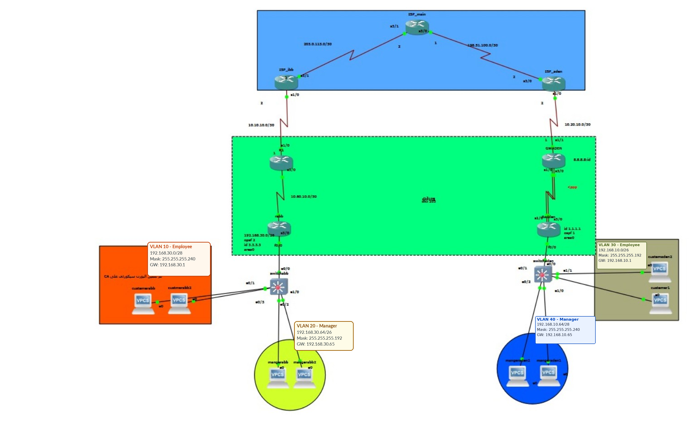

# Advanced Enterprise Network Design & Implementation

**Academic network engineering project | Ibb and Aden branches | ISP core with MPLS/LDP**

This repository documents a multi-branch enterprise WAN lab in a network simulator. It covers VLSM, VLAN segmentation, Router-on-a-Stick, OSPF, MPLS/LDP, PPP with CHAP, Multilink PPP evidence, and access-layer security topics.

> **Reproducibility note:** The native simulator project file was not available when this documentation package was assembled. This repository is a documentation and evidence package, not an importable simulator lab. It distinguishes supplied output from settings that still need independent verification.

## Network topology (latest annotated image)

The primary image is based on the project team's original diagram. Only the address/VLAN annotation labels were updated to match the latest confirmed addressing plan; the network topology was not redesigned. The untouched source image is preserved at [topology/Original-Topology.jpg](topology/Original-Topology.jpg). Enlarged crops from the same updated image are available for [Ibb VLAN 10 — Employee](topology/details/ibb-vlan10-employee.jpg), [Ibb VLAN 20 — Manager](topology/details/ibb-vlan20-manager.jpg), [Aden VLAN 30 — Employee](topology/details/aden-vlan30-employee.jpg), and [Aden VLAN 40 — Manager](topology/details/aden-vlan40-manager.jpg).

## Logical areas

1. **ISP core:** `ISP_Ibb`, `Main_ISP`, and `ISP_Aden`; `/30` provider links and the supplied Loopback/LDP identifiers.
2. **WAN edge:** `GW_Ibb` and `GW_Aden / GWADEN`.
3. **Ibb branch:** `R_Ibb / rabb`, access switch, Employee VLAN 10, and Manager VLAN 20.
4. **Aden branch:** `R_Aden / Radden`, access switch, Employee VLAN 30, and Manager VLAN 40.

## Technologies covered

- VLSM and IPv4 subnetting
- IEEE 802.1Q VLANs and Router-on-a-Stick
- OSPF
- MPLS and LDP
- PPP with CHAP
- Multilink PPP interface evidence
- Port Security
- STP (listed in the source report; independent configuration/output evidence is still missing)

## IPv4 VLAN plan

| Branch | VLAN | Role | Network | Mask | Gateway |
|---|---:|---|---|---|---|
| Ibb | 10 | Employee | `192.168.30.0/28` | `255.255.255.240` | `192.168.30.1` |
| Ibb | 20 | Manager | `192.168.30.64/26` | `255.255.255.192` | `192.168.30.65` |
| Aden | 30 | Employee | `192.168.10.0/26` | `255.255.255.192` | `192.168.10.1` |
| Aden | 40 | Manager | `192.168.10.64/28` | `255.255.255.240` | `192.168.10.65` |

The role mapping follows the project owner's latest clarification. The older Aden switch snippet contains inconsistent VLAN-name text; this documentation records the intended role mapping and does not claim the running VLAN database was re-read. Full point-to-point WAN addressing and usable ranges are in [`docs/IP-Addressing-Plan.md`](docs/IP-Addressing-Plan.md).

## Repository contents

- [`docs/Project-Report.html`](docs/Project-Report.html) — Arabic technical report referencing the latest annotated topology PNG and matching enlarged crops (keep folder paths intact).
- [`docs/IP-Addressing-Plan.md`](docs/IP-Addressing-Plan.md) — VLAN subnets, gateways, WAN `/30` links, and Loopback/LDP identifiers.
- [`topology/Network-Topology.png`](topology/Network-Topology.png) — latest annotated topology image with the corrected VLAN labels.
- [`topology/details/`](topology/details/) — enlarged crops of the original VLAN regions; no topology details were redrawn.
- [`evidence/README.md`](evidence/README.md) — captured evidence inventory and gaps.
- [`configs/README.md`](configs/README.md) — configuration handling and credential policy.
- [`tests/Verification-Matrix.md`](tests/Verification-Matrix.md) — concise validation checklist.

## Evidence status

Evidence currently described in the report includes MPLS LDP neighbor output, MPLS forwarding-table output, a ping to `198.51.100.2`, traceroute output, a Port Security status excerpt, and the latest `show ip interface brief` output from `Radden`.

Important limitations:

- Ping to `198.51.100.2` demonstrates reachability to the `ISP_Aden` address in that capture; it does **not** alone prove end-host-to-end-host connectivity across branch VLANs.
- `Radden`'s saved interface output shows `FastEthernet0/0.30` (`192.168.10.1`), `FastEthernet0/0.40` (`192.168.10.65`), and `Multilink1` (`10.70.10.2`) as `up/up`.
- The saved Port Security command uses `shutdown`, while the corresponding output reports `Restrict`; the two records must be reconciled before treating them as one verified state.
- Independent STP configuration/output was not retained.
- Whether Aden VLAN 40 is advertised through OSPF remains to be verified from running configuration or saved route output.
- The native simulator project was not supplied, so the original diagram cannot be interactively tested from this repository.

## Security

No CHAP shared secret or real credential should be committed. The public report omits the CHAP password. Do not add private keys, passwords, tokens, or environment-specific credentials to this repository.

## Suggested next evidence to add

1. `show ip ospf neighbor` and relevant route table output from the routers.
2. `show mpls ldp neighbor` and `show mpls forwarding-table` captures tied to device names and capture date.
3. STP state output and Port Security configuration/output from the same device and test.
4. Ping tests from one endpoint in each branch VLAN to the intended remote endpoint, plus gateway reachability.
5. Native simulator project and tool/version notes, if the file becomes available.

## Team

Prepared as an academic team project. The original report credits Huthaifa Labib Abualrijal, Khalid Waleed Hajeb, Amin Nabil Al-Maliki, and Razaz Rashad Nasari, supervised by Eng. Zakaria.

## Upload to GitHub

1. Extract the ZIP archive and upload the contents of the `Advanced-Network-Design-v5` folder to the repository root (not the ZIP file itself).
2. Keep the relative folder structure intact so the image and report links continue to work.
3. The latest image is `topology/Network-Topology.png`; the untouched reference is `topology/Original-Topology.jpg`.
4. Before committing, review `git status` and confirm there are no passwords, tokens, or private credentials.
